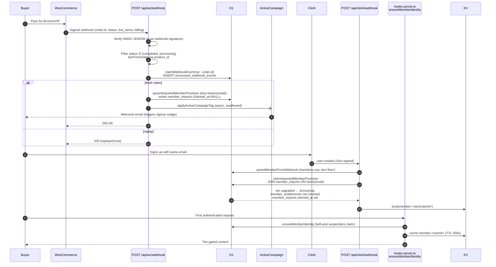

# Launch readiness brief

**Generated:** 2026-05-31
**Lens:** what to verify, build, or fix before opening the platform to real members
**Pairs with:** MAP.html · AARON-FRONTEND-ERD.html · LAUNCH-UX-UI-MAP.html · LAUNCH-FLOW-BOARD-GRAPHVIZ.html · AARON-RECONCILE.md

## Quick status — five lenses

| #   | Audit area             | Status | Summary                                                                                                                                                                                        |
| --- | ---------------------- | ------ | ---------------------------------------------------------------------------------------------------------------------------------------------------------------------------------------------- |
| 1   | WC → D1 → Clerk flow   | 🟡     | Email-keyed two-stage handoff works and is idempotent for WC retries, but KV-bust on tier upgrade, orphan sweep, refund revocation, and failure-claim-release are unguarded.                   |
| 2   | Member info inventory  | 🟡     | Identity core (Clerk + members) is solid, but `member_tags` is dead, notification prefs have no UI, WC drops phone/address, no TOS capture, role edit needs DB shell.                          |
| 3   | Sentry                 | 🔴     | SDK initializes but `logError` does not call Sentry, 10 server `console.error` sites unmigrated, no replay, no scope tagging, no DSN gating, no sourcemaps — diverges materially from spec 03. |
| 4   | Artillery / load test  | 🔴     | 600-VU scenarios exist but have never been run, are not wired into `package.json`, lack webhook + write-path coverage, and will fail p95 budget without L2/L3 cache.                           |
| 5   | WC → D1 bulk migration | 🔴     | Import CLI + DB upsert path exist, but the WC extractor, remote-D1 execution mode, idempotency receipts, reconciliation against WC, and stale-flagger are all missing.                         |

Legend: 🟢 launch-ready · 🟡 ship with documented risk · 🔴 must address before launch.

---

## 1. WC → D1 → Clerk end-to-end flow (the critical path)

### Sequence



### Where data is written

| Step                   | Table                                   | Key                           | Trigger                                                   |
| ---------------------- | --------------------------------------- | ----------------------------- | --------------------------------------------------------- |
| Idempotency claim      | `processed_webhook_events`              | (source, event_id) PK         | WC webhook, Clerk webhook                                 |
| Provision row          | `member_imports`                        | UNIQUE(lower(email))          | WC webhook                                                |
| Identity mirror        | `members`                               | clerk_user_id PK              | Clerk user.created/updated, ensureMemberIdentity fallback |
| Entitlement grant      | `member_entitlements`                   | (member_id, tier, source_ref) | claimImportedMemberProvision                              |
| Tier upgrade on member | `members.tier`, `members.access_status` | clerk_user_id                 | claimImportedMemberProvision, admin updateMember          |

### Idempotency mechanism

Composite PK `(source, event_id)` on `processed_webhook_events`. WC keys on `String(order.id)`, Clerk on Svix `svix-id`. First claim wins; retries return `{replayed:true}` with no downstream writes. `upsertImportedMemberProvision` is also row-level idempotent (UPSERT by lower(email)), so double-runs are safe even if the claim layer is bypassed.

### Edge cases & orphan states

- **Signup-before-purchase race:** Member signs in, then WC fires. Claim happens lazily via `ensureMemberIdentity` on next authenticated request — up to 300s KV-cache lag on tier visibility.
- **Orphan WC purchase:** Buyer pays, never creates a Clerk account. `member_imports` row sits with `claimed_at IS NULL` forever. No sweeper, no re-nudge.
- **Failure-mid-write:** Claim is taken on `processed_webhook_events` BEFORE D1 upsert. A D1 hiccup leaves the order claimed with no `member_imports` row; WC retries return `replayed:true` and do nothing → silent data loss.
- **Refund / cancellation:** No handler. Buyer keeps tier after refund.
- **Order corrected (bronze → vip):** Idempotency rejects the second delivery; tier stuck at bronze. Requires manual `/admin updateMember`.
- **Free-tier auto-creation:** Any Clerk signup gets `members` row with `tier='free'`. Confirm with Aaron that this is intentional and that 'free' content gates are public-with-account.

---

## 2. Member info inventory

### Field map

| Field                                           | Source touchpoint                       | D1 table.column                                           | Editable by               | Nullable               |
| ----------------------------------------------- | --------------------------------------- | --------------------------------------------------------- | ------------------------- | ---------------------- |
| clerk_user_id                                   | Clerk signup                            | members.clerk_user_id (PK)                                | system only               | no                     |
| email                                           | Clerk signup → webhook                  | members.email; member_imports.email                       | member (via Clerk)        | no                     |
| name                                            | Clerk signup OR WC billing first+last   | members.name                                              | member (via Clerk); admin | yes                    |
| email_verified                                  | Clerk verification                      | members.email_verified                                    | system only               | yes                    |
| tier                                            | WC product_id (31517=bronze, 31518=vip) | members.tier; member_entitlements.tier                    | WC webhook; admin         | no (defaults 'free')   |
| access_status                                   | WC webhook + admin                      | members.access_status                                     | WC webhook; admin         | no                     |
| role                                            | (unused; no UI)                         | members.role                                              | DB shell only             | no (defaults 'member') |
| source_ref                                      | WC order id                             | member_entitlements.source_ref; member_imports.source_ref | system only               | yes                    |
| locationCity / locationState                    | /account form                           | member_profiles.location_city / location_state            | member                    | yes                    |
| trainingGoal                                    | /account form                           | member_profiles.training_goal                             | member                    | yes                    |
| background.{civilian,le,military,medical,other} | /account form                           | member*profiles.background*\*                             | member                    | yes                    |
| ecqcAlumni / mucAlumni / otherCourses           | /account form (self-asserted)           | member_profiles.{ecqc_alumni, muc_alumni, other_courses}  | member                    | yes                    |
| carrySetup                                      | /account form                           | member_profiles.carry_setup                               | member                    | yes                    |
| showInFinder                                    | /account form                           | member_profiles.show_in_finder                            | member                    | yes                    |
| leaderboardOptIn                                | /account form                           | leaderboard_opt_in row                                    | member                    | yes                    |
| profileCompletedAt                              | /account form save                      | member_profiles.profile_completed_at                      | system on save            | yes                    |
| build_updates / livestream_reminders            | (no UI)                                 | member_notification_preferences.\*                        | nobody (no writer)        | yes                    |
| tags                                            | (no UI, no writer)                      | member_tags.{key,value}                                   | nobody — dead table       | yes                    |
| phone / billing address                         | (dropped from WC parse)                 | —                                                         | —                         | n/a                    |
| TOS accepted_at                                 | (not captured)                          | —                                                         | —                         | n/a                    |
| avatar_url                                      | (not synced from Clerk image_url)       | —                                                         | —                         | n/a                    |

### Minimum viable member contract

The only fields auth, tier gating, and entitlement checks require:
`members.clerk_user_id` · `members.email` · `members.name` · `members.email_verified` · `members.tier` · `members.access_status`.

Everything else (`member_profiles`, `member_tags`, `member_notification_preferences`, `leaderboard_opt_in`) is optional enrichment. Lock the invariant: **Clerk is source of truth for {email, name, email_verified}; D1 only mirrors via webhook.**

### Dead / orphan fields

- `member_tags` — table exists, no writer, no UI. Decide: ship admin write path or drop from migration 0013.
- `member_notification_preferences` — table exists, no UI. CAN-SPAM risk; members cannot opt out.
- `members.role` — no UI; admin promotion requires `wrangler d1 execute`.
- `members.avatar_url` — Clerk's `image_url` never synced.
- `/welcome` interstitial — captures nothing, ideal TOS gate is wasted.

---

## 3. Sentry — pre-launch state

**Status:** 🔴 Half-wired. SDK initializes incidentally; the contract in spec 03 / LEDGER is not honored.

### Current state

- Server `Sentry.init` runs unconditionally in `src/hooks.server.ts:11-15`, sequence wraps `handleError` via `Sentry.handleErrorWithSentry()` at line 79.
- Client `Sentry.init` runs unconditionally in `src/hooks.client.ts:3-8`, only `browserTracingIntegration` — no replay.
- `logError` in `src/lib/server/log.ts:6-13` is a labeled `console.error` only — **does not call `Sentry.captureException`** despite LEDGER:277 claiming it does.
- No `@sentry/vite-plugin` in `vite.config.ts`; sourcemap upload deferred.
- Env vars: `SENTRY_DSN` + `VITE_SENTRY_DSN`. Spec calls for `PUBLIC_SENTRY_DSN` + `PUBLIC_SENTRY_ENV`.

### Gaps (must close before launch)

1. **No conditional DSN gating** — `Sentry.init` runs even when DSN is empty (works in no-op transport mode but violates spec).
2. **`logError` does not push to Sentry** — foundational gap; every explicit log path bypasses Sentry.
3. **10 unmigrated server-side `console.error` sites:** `hooks.server.ts:70`, `admin/+page.server.ts:229`, `account/+page.server.ts:185,197`, `api/clerk/webhook/+server.ts:53,98`, `lib/server/clerk.ts:79`, `lib/server/d1-compat.ts:155,163,193`.
4. **No client replay integration.** Spec mandates `replayIntegration({ maskAllText: true, blockAllMedia: true })` with `replaysOnErrorSampleRate: 1.0`.
5. **No scope tagging** — `handleErrorWithSentry()` called bare, no `clerkUserId`/`route`/`environment` tags.
6. **No `buildErrorPayload` / `classify` / `eventId`** — boundaries can't render Report ID.
7. **No sourcemap upload** — production stack traces will be minified.
8. **Env-var name drift** — spec vs impl mismatch (`PUBLIC_` vs `VITE_`).

### Verify-after-DSN-paste recipe

1. Set `SENTRY_DSN` and `VITE_SENTRY_DSN` locally (Doppler/Cloudflare env).
2. `pnpm build && pnpm preview`.
3. Hit a new dev-only route `/api/_sentry-test` that throws on purpose.
4. Confirm event in Sentry with tags `route=/api/_sentry-test` + `clerkUserId`.
5. Send a Clerk webhook with a bad Svix signature → confirm Sentry event with `scope=clerk.webhook`.
6. Click a debug-throw button in the client → confirm replay attached.

---

## 4. Artillery load test — pre-launch state

**Status:** 🔴 Two parallel suites exist; the 600-VU file has never been executed.

### Current state

- `artillery/` (smoke.yml, base.yml, authenticated.yml) — wired via `pnpm load:smoke/load:base/load:auth`, but peak is ~20 arrival/s (well below launch).
- `tests/load/scenarios.yml` — the only 600-VU ramp (5/s → 200/s sustained, p95<1500ms, p99<3000ms, maxErrorRate 1%) — **NOT wired into `package.json`**. Referenced in LOAD-TEST-PLAN.md but no operator entrypoint.
- No WC webhook signature scenario. No progress-write scenario. No ensure thresholds on `artillery/*.yml`.
- Default target is `http://localhost:4173` — risk of "load tested" meaning "tested vite preview".
- No recorded baseline; no `report.json` committed.

### Pre-launch gaps

1. `pnpm load:full` not defined — operators run the wrong file.
2. No WC webhook burst scenario (HMAC-signed POST burst).
3. No progress-write scenario (POST `/api/library/episodes/[id]/progress`) — biggest D1 write risk.
4. No `ensure` block on smoke/base/authenticated — README thresholds are prose only.
5. Authenticated suite needs manual Clerk cookie paste — single-user, no CI path.
6. Localhost default makes false confidence easy.

### Honest call-out: KV cache gap

`/api/members` polled at weight 25 (~50 req/s arrival sustained) and library reads go straight to D1. **Without L2 `setHeaders` + L3 Cache API in place, the 600-VU run will almost certainly miss `p95<1500ms`.** The result will be uninformative — it will reproduce the architecture doc's existing prediction rather than surface new bugs. Either land cache layers first, lower the VU target for the first pass, or run-and-accept the breach with a LEDGER risk entry.

### Next steps

- Wire `pnpm load:full → artillery run tests/load/scenarios.yml`.
- Make `LOAD_TARGET` required; remove `localhost` default.
- Add `ensure` blocks to all `artillery/*.yml`.
- Author `tests/load/webhook.yml` (HMAC processor) and `tests/load/writes.yml` (progress writes).
- Run once against `staging.shivworks-network.pages.dev`; commit `report.json` + LEDGER baseline.

---

## 5. WC → D1 bulk migration plan

**Status:** 🔴 Building blocks exist; the extractor + safe execution mode + reconciliation are missing.

### What's already built

- `scripts/bulk-import.ts` — CSV parse, batched (50), `--dry-run`, calls `upsertImportedMemberProvision`.
- `parseImportedMemberCsv` + `normalizeImportedTier` (broad header aliases, tier mapping).
- `upsertImportedMemberProvision` — UPSERT by lower(email), idempotent.
- `member_imports` schema with UNIQUE(email), `claimed_at`, `last_emailed_at`.

### What Aaron needs to provide

1. **WC REST API credentials** for `shivworkspg.com` — read-only consumer key + secret. Store in Infisical/1Password.
2. **WC product IDs for Bronze and VIP** — confirmed from the WC admin (we currently assume 31517=bronze, 31518=vip; verify against the live store).
3. **Confirmation** that he is OK with the migration writing to production D1 via `wrangler d1 execute --remote`.

### What we run (recipe)

```
# 1. Extract — produces buyers.csv
pnpm tsx scripts/wc-export.ts \
  --wc-url https://shivworkspg.com \
  --bronze-product-id <ID> --vip-product-id <ID> \
  --out .planning/migration/buyers.csv

# 2. Eyeball — row count, tier distribution
wc -l .planning/migration/buyers.csv
awk -F, '{print $2}' .planning/migration/buyers.csv | sort | uniq -c

# 3. Dry-run against local D1
pnpm tsx scripts/bulk-import.ts \
  --csv .planning/migration/buyers.csv --dry-run

# 4. Production import (gated)
CONFIRM=yes pnpm tsx scripts/bulk-import.ts \
  --csv .planning/migration/buyers.csv \
  --env production \
  --receipt .planning/migration/buyers.import-receipt.jsonl

# 5. Reconcile — exits non-zero on mismatch
pnpm tsx scripts/wc-reconcile.ts \
  --wc-url https://shivworkspg.com \
  --bronze-product-id <ID> --vip-product-id <ID>

# 6. Commit receipt + reconcile output to .planning/migration/ as audit trail.
```

### How we verify

- Reconcile script exits 0 (per-tier counts match WC).
- Spot-check 5 buyers: query `member_imports` by email, confirm tier matches the WC order.
- Pick one unclaimed buyer, sign up as them in Clerk (in staging), confirm `members.tier` flips to bronze/vip and `member_entitlements` row appears.

### Stale-import handling (post-launch)

`scripts/flag-stale-imports.ts` runs weekly via cron: `SELECT email FROM member_imports WHERE claimed_at IS NULL AND created_at < now-30d` → ops re-invite. Do NOT auto-revoke unclaimed rows — they paid.

---

## Prioritized to-do (consolidated)

### Today (now-able, Max)

- [ ] Rewrite `src/lib/server/log.ts` so `logError` calls `Sentry.captureException` with scope tag + extra context. · 15 min · no blocker · _Sentry_
- [ ] Migrate the 10 server-side `console.error` sites to `logError(scope, err, ctx)`. · 30 min · no blocker · _Sentry_
- [ ] Add conditional DSN gating in both `hooks.{server,client}.ts`; add client replay integration; add scope-tagging callback to `handleErrorWithSentry`. · 45 min · no blocker · _Sentry_
- [ ] Wire `pnpm load:full → artillery run tests/load/scenarios.yml`; remove/rename duplicate `artillery/` smoke. · 10 min · no blocker · _Artillery_
- [ ] Add `ensure` thresholds (p95<1500, maxErrorRate<1) to `artillery/{base,authenticated,smoke}.yml`. · 15 min · no blocker · _Artillery_
- [ ] Make `LOAD_TARGET` required (no localhost default) in `tests/load/scenarios.yml`. · 5 min · no blocker · _Artillery_
- [ ] Add `bust(kv, member:<clerkUserId>)` to WC webhook after successful upsert when a matching member row already exists. · 1 hr · no blocker · _WC Flow_
- [ ] Reorder WC webhook so D1 upsert happens BEFORE the idempotency claim (or release the claim on upsert failure). · 45 min · no blocker · _WC Flow_
- [ ] Fix Clerk webhook to use `getPrimaryEmail()` resolver (already exists) instead of `email_addresses[0]`. · 15 min · no blocker · _Member info_
- [ ] Add admin role-management UI to `/admin updateMember` so additional admins can be promoted without DB shell. · 45 min · no blocker · _Member info_
- [ ] Build `scripts/wc-export.ts` (WC REST → buyers.csv). · 2 hr · awaits WC keys + product IDs · _Migration_
- [ ] Add `--env` flag + JSONL receipt + `CONFIRM=yes` gate to `scripts/bulk-import.ts`. · 1.5 hr · no blocker · _Migration_
- [ ] Build `scripts/wc-reconcile.ts` (per-tier count diff, non-zero on mismatch). · 1 hr · no blocker · _Migration_
- [ ] Define and document the "minimum viable member" contract in `.planning/architecture/`. · 30 min · no blocker · _Member info_

### Aaron tonight (external dependencies)

- [ ] Create Sentry SvelteKit project; generate DSN + org-scoped `SENTRY_AUTH_TOKEN`; paste into Doppler/Cloudflare env + GitHub Actions secrets. · 15 min · _Sentry_
- [ ] Provide WC REST API consumer key + secret (read-only) for `shivworkspg.com`. · 15 min · _Migration_
- [ ] Confirm Bronze + VIP WooCommerce product IDs from the WC admin. · 5 min · _Migration_
- [ ] Decide whether `free`-tier auto-creation on any Clerk signup is intended (if not, allowlist gate `ensureMemberIdentity`). · 15 min decision · _WC Flow_
- [ ] Decide whether refund/cancellation should revoke tier for launch. · 15 min decision · _WC Flow_
- [ ] Provide WC webhook shared secret for staging so load-test can sign payloads. · 10 min · _Artillery_
- [ ] Provide legal TOS copy + decide capture surface (`/welcome` or `/signup` post-step). · _Member info_
- [ ] Confirm UX placement for notification-preferences UI (in `/account` vs `/settings/notifications`). · _Member info_
- [ ] Confirm Active Campaign tag actually triggers the welcome-email automation (send a real test purchase to a throwaway email). · 30 min · _WC Flow_

### Tomorrow (post-secrets)

- [ ] Add `sentrySvelteKit({ sourceMapsUploadOptions })` to `vite.config.ts` gated on `SENTRY_AUTH_TOKEN`. · 30 min · awaits Aaron · _Sentry_
- [ ] Implement `buildErrorPayload` + `classify()` returning `{message, code, eventId}`; update `+error.svelte` boundaries to render Report ID. · 1 hr · _Sentry_
- [ ] Add dev-only `/api/_sentry-test` route + documented verification runbook; run end-to-end and confirm tags + replay arrive. · 45 min · awaits Aaron · _Sentry_
- [ ] Configure Sentry alert rules (INTERNAL_ERROR → Slack, UPSTREAM_FAILURE rate, RATE_LIMITED per-user). · 20 min · Sentry UI · _Sentry_
- [ ] Author `tests/load/webhook.yml` with HMAC-signing `processor.js`, burst 50/s for 30s against staging. · 1.5 hr · awaits Aaron · _Artillery_
- [ ] Author `tests/load/writes.yml` (POST progress) with seeded Clerk sessions on staging. · 2 hr · _Artillery_
- [ ] Decide cache strategy: land L2 `setHeaders` + L3 Cache API for `/`, `/api/members`, `/library` OR accept p95 breach with LEDGER risk entry. · 4-8 hr if landing cache · _Artillery_
- [ ] Run `tests/load/scenarios.yml` against `staging.shivworks-network.pages.dev`; commit `report.json` + LEDGER baseline. · 30 min · _Artillery_
- [ ] Run `wc-export` against production WC; eyeball CSV with Aaron before any write. · 30 min · awaits Aaron · _Migration_
- [ ] Run `bulk-import --env production` with receipt; immediately follow with `wc-reconcile`; commit both to `.planning/migration/` as the audit trail. · 30 min · _Migration_
- [ ] End-to-end WC→Clerk test (new email): verify `member_imports` row, then signup → `members.tier=bronze/vip` and entitlement row. · 30 min · _WC Flow_
- [ ] Test signup-before-purchase race; confirm tier upgrade visible within one request cycle after KV-bust fix. · 20 min · _WC Flow_
- [ ] Test WC retry idempotency (same `order.id` re-sent → `{replayed:true}`, no duplicate rows). · 10 min · _WC Flow_
- [ ] Extend `WcBillingSchema` to capture phone + address; persist into `member_profiles` or new `member_contact`. · 2 hr · awaits WC admin confirmation that fields are collected · _Member info_
- [ ] Ship notification-prefs UI (writes `member_notification_preferences`). · 2 hr · awaits Aaron UX decision · _Member info_
- [ ] Ship TOS acceptance capture at `/welcome` (writes `members.tos_accepted_at` — new column). · 2 hr · awaits Aaron copy · _Member info_
- [ ] Decide fate of `member_tags`: ship admin write path OR drop from migration 0013. · 30 min decision; 2-3 hr if shipping · _Member info_

### Post-launch

- [ ] Build orphan / stale-import sweeper: `scripts/flag-stale-imports.ts` (claimed_at IS NULL AND created_at < now-30d), wire weekly cron. · 1 hr · _Migration / WC Flow_
- [ ] Build reconciliation script: surface `member_imports.claimed_at IS NULL` orphans pre-launch and weekly. · 1 hr · _WC Flow_
- [ ] Add refund/cancellation handler that writes `members.access_status='revoked'` via `updateMemberTier`. · 1 hr · awaits Aaron decision · _WC Flow_
- [ ] Document email-casing normalization invariant; normalize on insert in both `members` and `upsertMemberFromWebhook`. · 30 min · _WC Flow_
- [ ] Document Clerk testing-tokens / sign-in helper pattern in `tests/load/README.md`; bootstrap N test sessions for authenticated load runs. · 2 hr · _Artillery_
- [ ] Audit invariant: `members.{email,name,email_verified}` only written by Clerk webhook; add a test. · 1 hr · _Member info_
- [ ] Sync Clerk `image_url` → `members.avatar_url` (new column). · 45 min · _Member info_
- [ ] Verification path for self-asserted ECQC/MUC alumni claims via admin + `member_tags`. · 2 hr · ties to `member_tags` decision · _Member info_
- [ ] Either rename env vars to `PUBLIC_SENTRY_DSN`/`PUBLIC_SENTRY_ENV` per spec, or update spec 03 to match impl. · 20 min · _Sentry_
