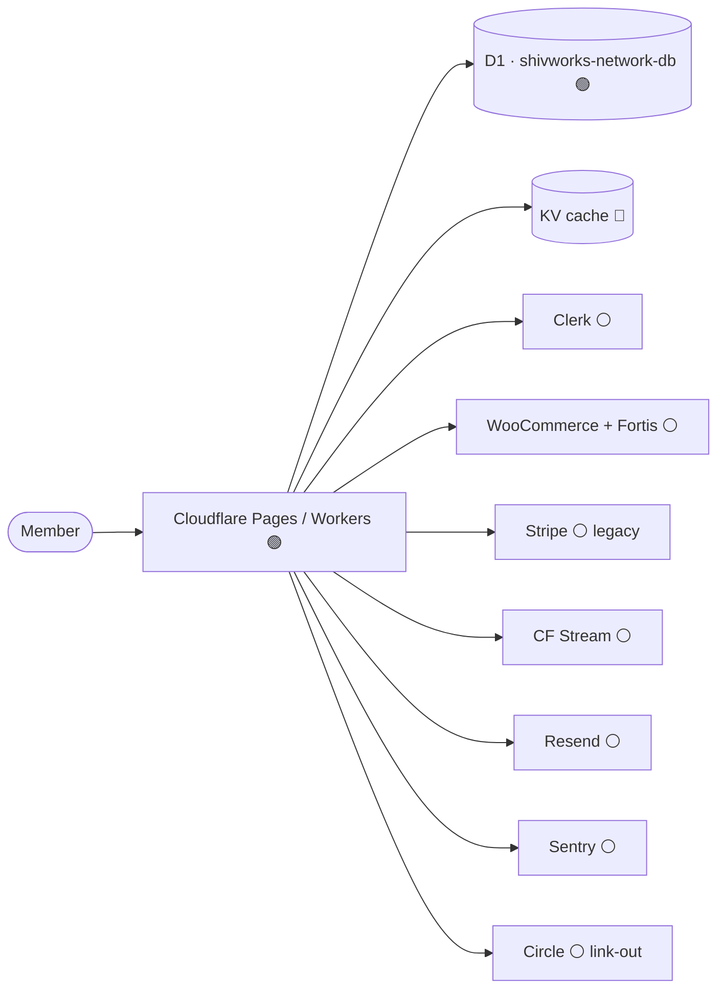
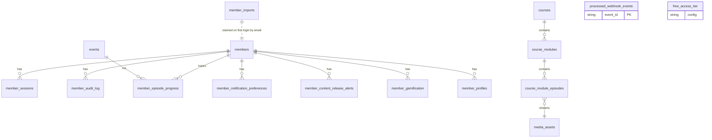
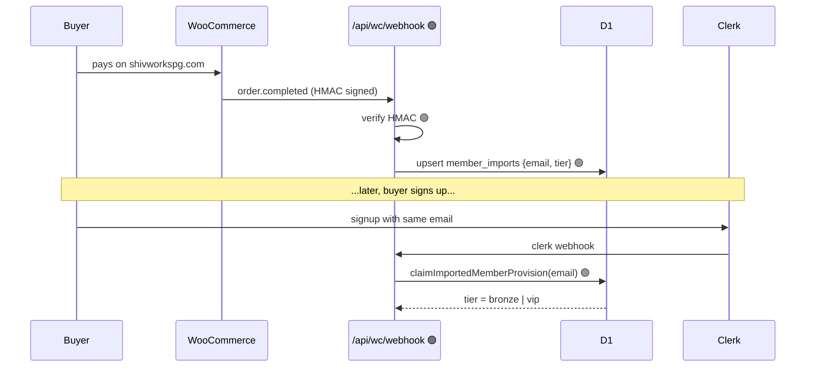
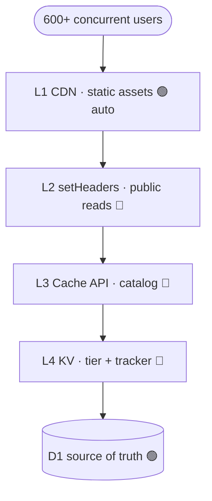
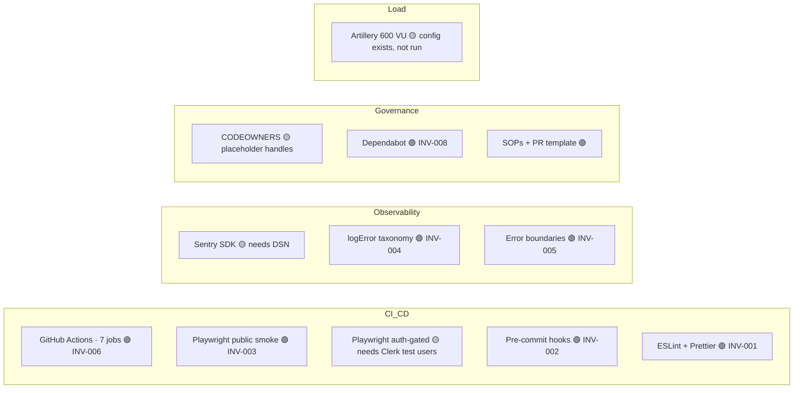

# ShivWorks Network — Architecture Map

**Last updated:** 2026-05-30
**Owner:** Max
**Purpose:** living map of what's built, what's pending, and what's blocked. Updated after every merged PR.

## Legend

| Pill | Meaning                                                                   |
| ---- | ------------------------------------------------------------------------- |
| 🟢   | Shipped — code merged + verified                                          |
| 🟡   | Wired in code, pending external action (secrets, DNS, third-party config) |
| 🔴   | Not built — pre-launch blocker                                            |
| ⚪   | Third-party / out of repo                                                 |

## Update protocol

1. When a PR merges, flip the relevant node's pill and add one line to **Changelog** at the bottom.
2. When a 🔴 unblocks, change to 🟢 and link to the invoice (INV-XXX) or PR.
3. When a 🟡 clears, change to 🟢 and note who unblocked it.

---

## 1. System overview



---

## 2. Frontend routes

```mermaid
graph TB
  subgraph Public
    L[/ 🟢]
    LI[/login 🟢]
    SU[/signup 🟢]
    W[/welcome 🟢]
    CO[/checkout 🟢 wired to WC]
    SM[/sitemap.xml 🟢]
  end
  subgraph Member
    D[/dashboard 🟢]
    LIB[/library 🟢]
    LIVE[/live 🟢]
    UP[/updates 🟢]
    VIP[/vip-calls 🟢]
    COM[/community 🟢 Circle link]
    SET[/settings 🟢]
  end
  subgraph Admin
    A[/admin 🟢 imports + media]
  end
  subgraph Boundaries
    EB[+error.svelte × 7 🟢 INV-005]
  end
```

---

## 3. Backend API

```mermaid
graph LR
  subgraph Auth
    HS[hooks.server.ts 🟢]
    SS[session-security 🟢]
    G[guards 🟢]
  end
  subgraph Webhooks_in
    WCW[/api/wc/webhook 🟢 INV-009]
    CLW[/api/clerk/webhook 🟢]
    STW[/api/stripe/webhook 🟢 legacy]
    SMW[/api/webhooks/stream 🟢]
  end
  subgraph Routes
    LIBA[/api/library/* 🟢]
    EVA[/api/events/rsvp 🟢]
    VIPA[/api/vip-calls/request 🟢]
    SETA[/api/settings/sessions 🟢]
    ADMA[/api/admin/media 🟢]
    GAM[/api/gamification 🟢]
    MEM[/api/members 🟢]
  end
  subgraph Infra
    RL[rate-limit 🟢]
    ID[webhook-idempotency 🟢]
    LOG[log + Sentry 🟢 INV-004]
  end
```

---

## 4. Database — D1 (12 migrations applied locally, 🟡 remote pending)



**Migrations:** 0001 identity · 0002 free-tier · 0003 playback · 0004 module-progress · 0005 imports · 0006 notif-prefs · 0007 release-alerts · 0008 media+episodes · 0009 webhook-idempotency · 0010 indexes · 0011 gamification · 0012 profiles

---

## 5. Critical flow — WC purchase → member provisioning



**🟡 Blocked on:** Aaron pasting `WC_WEBHOOK_SECRET` into both Infisical and WC admin (see Phase 1 of GO-LIVE-RUNBOOK).

---

## 6. Cache architecture — THE GAP



**Why it's a blocker:** dashboard load = 3–5 D1 reads × 600 users = ~3k reads/min just for hydration. Will throttle under load test.
**Targets:** `members.tier` lookup (L4 KV), course catalog (L3 Cache API), tracker count (L4 KV write-through).

---

## 7. Quality & ops rails



---

## 8. Pre-launch checklist

### Aaron blockers 🟡

- [ ] Infisical secrets: `CLERK_SECRET_KEY`, `CLERK_PUBLISHABLE_KEY`, `WC_WEBHOOK_SECRET`, `SENTRY_DSN`, `VITE_SENTRY_DSN`, `RESEND_API_KEY`, `RESEND_FROM_EMAIL`
- [ ] WC admin: webhook → `https://network.shivworks.com/api/wc/webhook` with secret
- [ ] DNS: `network.shivworks.com` → CNAME `shivworks-network.pages.dev`
- [ ] CF bindings: `DB` → D1, `KV` → namespace, custom domain SSL
- [ ] Sentry: create project, paste DSN

### Engineering blockers 🔴

- [ ] L4 KV cache implementation (tier lookup + tracker count)
- [ ] L2 setHeaders on public read endpoints
- [ ] L3 Cache API on course catalog
- [ ] Auth-gated Playwright smoke (after Clerk test users provisioned)
- [ ] Sentry sourcemap upload in CI (after `SENTRY_AUTH_TOKEN` in GH secrets)
- [ ] Run Artillery 600-VU load test against staging

### Migrations 🟡

- [ ] `pnpm migrate` against remote D1 (migrations 0001–0012)
- [ ] Verify `processed_webhook_events`, `member_gamification`, `member_profiles` present

### Micah blockers 🟡

- [ ] Enable branch protection on `main` (require: check, lint, format, unit, build, smoke, CODEOWNER review)
- [ ] Replace `@TBD-*` placeholders in CODEOWNERS

---

## 9. Shipped invoices

| ID       | Title                                               | Status |
| -------- | --------------------------------------------------- | ------ |
| INV-001  | Lint + format baseline                              | 🟢     |
| INV-002  | Pre-commit hooks                                    | 🟢     |
| INV-003a | Playwright public smoke                             | 🟢     |
| INV-003b | Playwright auth-gated                               | 🟡     |
| INV-004  | Sentry SDK wiring                                   | 🟢     |
| INV-005  | Error boundaries + taxonomy                         | 🟢     |
| INV-006  | CI pipeline + PR template                           | 🟢     |
| INV-007  | Security hardening pass 1                           | 🟢     |
| INV-008  | Governance (CODEOWNERS + Dependabot + CONTRIBUTING) | 🟢     |
| INV-009  | WC webhook + member-imports                         | 🟢     |

---

## Changelog

- **2026-05-30** — Map created. Reflects state after merge of `fix/checkout-wire-to-wc` (PR #23).
