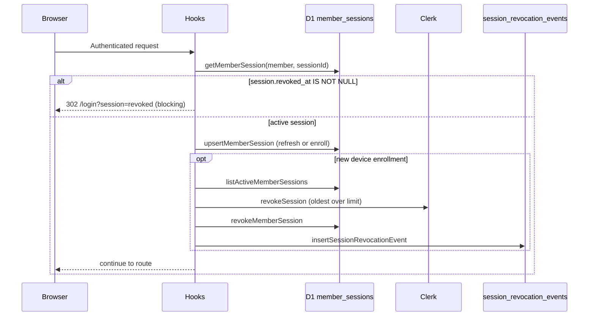

# Session revocation and device enrollment

Reliable session revocation enforcement without signing users out on routine navigation.

## Problem (pre-change)

| Gap                                                    | Impact                                          |
| ------------------------------------------------------ | ----------------------------------------------- |
| Auto-revoke disabled on every request                  | Account-sharing limit not enforced              |
| `upsertMemberSession` cleared `revoked_at` on conflict | Revoked sessions could regain access            |
| Hooks treated session sync as non-fatal telemetry      | Revoked Clerk cookies still worked until expiry |
| No immutable audit trail                               | Forensics and compliance gaps                   |
| Manual revoke API had no error handling / audit        | Partial revocations possible                    |

## Architecture



## Revocation lifecycle

1. **Enrollment** — First time a `session_id` is seen for a member (`getMemberSession` returns null), upsert creates the row and triggers device-limit enforcement.
2. **Navigation** — Known, non-revoked sessions only refresh `last_active_at`. No Clerk revokes.
3. **Manual revoke** — Member revokes another device via `/api/settings/sessions/:id/revoke`. Clerk + D1 + audit event; cannot revoke current session from this endpoint.
4. **Device-limit revoke** — On new enrollment, if active count exceeds `MEMBER_ACTIVE_SESSION_LIMIT` (2), oldest non-current sessions are revoked and member receives `sendSessionSecurityEmail`.
5. **Access block** — Any request where D1 shows `revoked_at` for the current `session_id` clears `locals` and redirects to login (or 401 for data requests).

## Policy constants

`src/lib/constants/session-policy.ts`

- `MEMBER_ACTIVE_SESSION_LIMIT = 2`
- Reasons: `member_revoked`, `device_limit_exceeded`, `admin_revoked`, `clerk_sync`

## Data model

### `member_sessions` (existing)

Operational state per Clerk session: device label, IP, activity timestamps, `revoked_at`, `revoke_reason`.

**Change:** upsert no longer clears `revoked_at` on conflict — revocation is sticky until the session row is unused.

### `session_revocation_events` (migration `0037`)

Immutable append-only audit log for every revocation.

## Monitoring

Structured logs (search in Workers/Pages logs):

| Event                             | When                                                 |
| --------------------------------- | ---------------------------------------------------- |
| `session_access_blocked`          | Revoked session hit the app                          |
| `session_revoked`                 | Successful revocation (includes `clerkRevoked` flag) |
| `session_revocation_clerk_failed` | Clerk API error; D1 still marked revoked             |
| `session_revocation_email_failed` | Notification email failed                            |

Query audit trail per member:

```sql
SELECT * FROM session_revocation_events
WHERE member_id = ?
ORDER BY created_at DESC
LIMIT 50;
```

## Deployment

1. Apply migration `0037_session_revocation_audit.sql` to D1 (local + remote).
2. Deploy application code (hooks blocking + enrollment enforcement).
3. Verify: revoke a session in Settings → other device loses access on next navigation.

## Tests

- `session-security.test.ts` — block revoked, no revoke on navigation, limit on enrollment
- `session-revocation.test.ts` — audit trail, Clerk failure tolerance, email on auto-revoke
