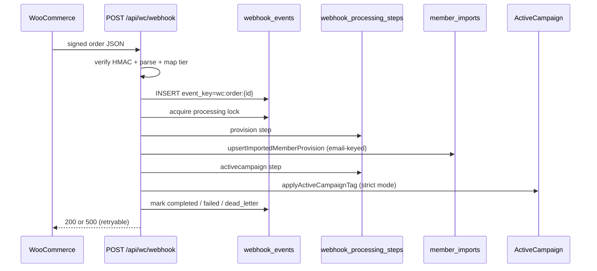

# WooCommerce Webhook Pipeline

Production-grade purchase webhook processing for ShivWorks Network.

## Goals

- Duplicate WooCommerce deliveries must not double-provision members
- Failed steps are recoverable with exponential backoff and admin replay
- Operators can inspect failures immediately in `/admin/webhooks`
- Every inbound order is traceable end-to-end via durable event + step audit log

## Architecture



## Pipeline stages

| Stage                | Responsibility                                                             | Failure mode                                     |
| -------------------- | -------------------------------------------------------------------------- | ------------------------------------------------ |
| Validation           | Signature, JSON shape, order status, tier mapping                          | 4xx — WC should not retry                        |
| Durable event record | `webhook_events` with `event_key`, payload hash, snapshot                  | UNIQUE on `event_key` dedupes ingress            |
| Processing queue     | DB-backed statuses: `received → processing → completed/failed/dead_letter` | `next_retry_at` schedules automatic retry window |
| Member provisioning  | `upsertImportedMemberProvision`                                            | Critical — blocks completion                     |
| ActiveCampaign sync  | `applyActiveCampaignTag({ strict: true })`                                 | Retryable — replays skip succeeded steps         |
| Audit log            | `webhook_processing_steps` per step attempt                                | Immutable trace                                  |

## Idempotency strategy

1. **Ingress:** `event_key = wc:order:{orderId}` UNIQUE constraint
2. **Concurrency:** `tryAcquireWebhookProcessingLock` only transitions `received|failed → processing`
3. **Provisioning:** email-keyed UPSERT in `member_imports` (existing behavior)
4. **Replay:** completed events return `{ replayed: true }` without side effects
5. **Step resume:** succeeded steps are skipped on retry/replay

## Retry and dead letter

- `max_attempts = 5`
- Backoff: `min(5m * 2^(attempt-1), 1h)`
- After exhaustion: `status = dead_letter` (visible in admin failure queue)
- Admin replay resets `failed|dead_letter → received` and re-runs pipeline from stored `payload_snapshot`

## Observability

| Surface              | Path                                    |
| -------------------- | --------------------------------------- |
| Metrics dashboard    | `/admin/webhooks`                       |
| Failure queue        | filter `status=failed` or `dead_letter` |
| Event detail + steps | `/admin/webhooks?event={id}`            |
| Replay tooling       | Admin form action `replayEvent`         |

## Schema

Migration: `migrations/0036_webhook_pipeline.sql`

- `webhook_events` — durable event record
- `webhook_processing_steps` — per-step audit log

Legacy `processed_webhook_events` remains for Clerk/Stream handlers.

## Rollback strategy

1. Revert handler to previous `claimWebhookEvent` + inline provision path
2. Apply no new writes to `webhook_events` (tables can remain)
3. `DROP TABLE webhook_processing_steps; DROP TABLE webhook_events;` when safe

Production D1 data in `member_imports` is unaffected by rollback — only observability tables are removed.

## Race conditions addressed

| Risk                           | Mitigation                                                                 |
| ------------------------------ | -------------------------------------------------------------------------- |
| Concurrent duplicate delivery  | UNIQUE `event_key` + processing lock                                       |
| Claim-before-write silent loss | Removed WC usage of `releaseWebhookEvent`; completion tied to step success |
| AC failure after provision     | Step-level audit; replay resumes at failed step                            |
| Operator blind to failures     | Admin webhooks console with metrics + replay                               |

## Testing

```bash
pnpm test src/lib/server/wc-webhook-pipeline.test.ts
pnpm test src/lib/server/webhook-idempotency.test.ts
```
